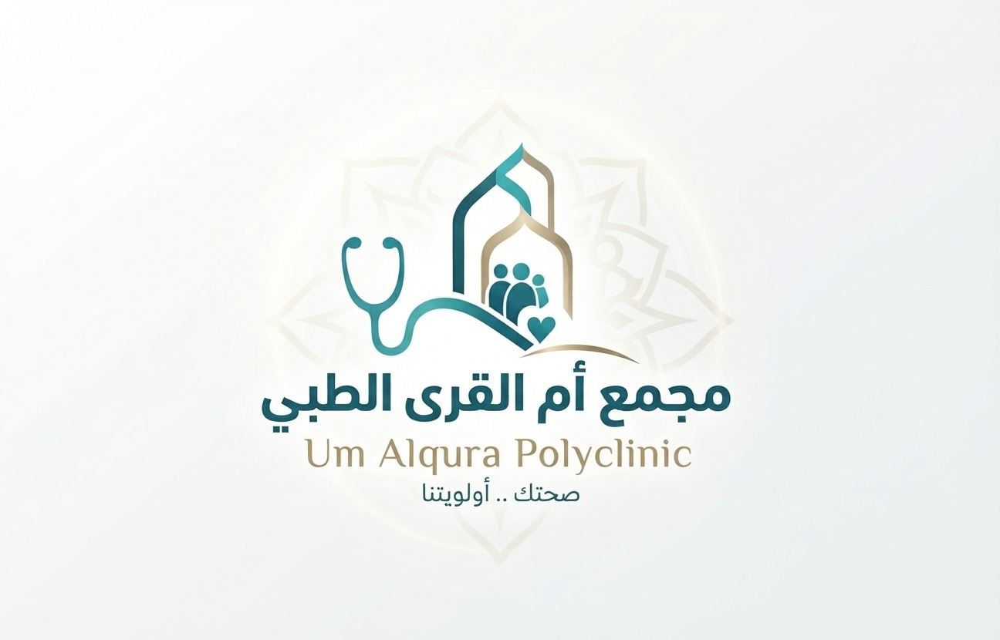

<div dir="rtl" align="right">

<div align="center">



# مجمع أم القرى الطبي ومصنع المستلزمات التأهيلية

### Um Alqura Polyclinic & Rehabilitation Manufacturing — Enterprise ERP 2026

**بركاء، سلطنة عمان** · _صحتك .. أولويتنا_

[](https://github.com/omancompany/um-alqura-polyclinic/actions/workflows/deploy.yml)

🌐 **النسخة الحية:** [omancompany.github.io/um-alqura-polyclinic](https://omancompany.github.io/um-alqura-polyclinic/)

</div>

---

| | |
|---|---|
| **الجهة المالكة** | مجمع أم القرى الطبي (ش.م.م) |
| **الموقع** | سلطنة عمان، محافظة جنوب الباطنة، ولاية بركاء، الصومحان الجنوب، بناية R&B، بالقرب من مستشفى بدر السماء |
| **التخصص المعتمد** | العلاج الطبيعي والتأهيل الطبي فقط (Physiotherapy & Rehabilitation Only) |
| **هواتف التواصل** | ‎+968 79470050 / ‎+968 94545025 |
| **تاريخ التحديث** | نوفمبر 2026 |

## المحتويات

1. [الهوية المؤسسية والضوابط الشرعية والثقافية](#1-الهوية-المؤسسية-والضوابط-الشرعية-والثقافية)
2. [الهيكلية المعمارية للنظام](#2-الهيكلية-المعمارية-للنظام)
3. [الحزمة التقنية](#3-الحزمة-التقنية)
4. [مخطط قاعدة البيانات](#4-مخطط-قاعدة-البيانات)
5. [التشغيل المحلي والنشر](#5-التشغيل-المحلي-والنشر)

---

## 1. الهوية المؤسسية والضوابط الشرعية والثقافية

_(Cultural & Clinical Compliance)_

### الفصل التام ومطابقة الكادر الطبي

- **الكادر النسائي** (أخصائية العلاج الطبيعي: د. سبأ البلوشية والمساعدات بالعباءة المحتشمة) يعالج المريضات الإناث فقط في أجنحة خاصة ومستقلة.
- **الكادر الرجالي** (أخصائي العلاج الطبيعي بالدشداشة العمانية والكمة) يعالج المرضى الذكور فقط.

### مواعيد العمل الرسمية

| الأيام | الفترة الصباحية | الفترة المسائية |
|---|---|---|
| السبت إلى الخميس | 9:00 صباحاً – 1:00 ظهراً | 4:00 عصراً – 8:00 مساءً |
| الجمعة | إجازة رسمية — مغلق | |

### هيكل التسعير المعتمد

| الخدمة | السعر |
|---|---|
| الكشف والاستشارة الأولية | 3 ر.ع (OMR) |
| الجلسة العلاجية الفردية | 15 ر.ع (OMR) |
| باقات وكورسات العلاج (5 جلسات فأكثر) | خصم 10% تلقائي |

### الأجهزة الطبية المتوفرة بالمجمع

موثقة بصور فوتوغرافية حقيقية داخل النظام:

1. جهاز شد الفقرات القطنية والعنقية الرقمي (Digital Cervical & Lumbar Traction Device).
2. جهاز الموجات الصدمية المتقدم (BTL Shockwave Therapy Device).
3. الجهاز المدمج للتحفيز الكهربائي والموجات فوق الصوتية (Combined Electrotherapy + Ultrasound).
4. جهاز الضغط الهوائي التموجي للأطراف وعلاج احتباس السوائل (Sequential Air Compression Lymphatic Therapy).

### ألوان الهوية البصرية (Brand Identity)

| اللون | الرمز | الاستخدام |
|---|---|---|
| الزيتي الداكن (Dark Teal) | `#075563` | اللون الأساسي |
| التركواز الطبي (Teal) | `#2A9DA5` | اللون الثانوي |
| الذهبي الهادئ (Calm Gold) | `#B59B62` | لمسات التمييز |
| العاجي الفاتح (Ivory) | `#FAF8F1` | الخلفية |
| رمادي النصوص الطبي (Medical Text) | `#24383B` | النصوص |

---

## 2. الهيكلية المعمارية للنظام

_(Enterprise Dual-Entity Architecture)_

ينقسم النظام إلى جناحين رئيسيين مترابطين عبر قاعدة بيانات موحدة.

### الجناح الأول: الإدارة التنفيذية ومصنع المستلزمات الطبية التأهيلية (Enterprise ERP & MRP II)

1. **لوحة الإدارة التنفيذية الموحدة (Executive Management Dashboard)**
   - مراقبة لحظية لمؤشرات الأداء التشغيلي والمالي المشترك.
   - متابعة تقييم المخزون المالي في المستودعات الثلاثة.
   - قياس كفاءة خطوط الإنتاج ونسب الإنجاز الفعلي مقابل المخطط.
   - إجمالي إيرادات المصنع والعيادات مع الضريبة.

2. **منظومة المستودعات الثلاثية (3-Warehouse Management System — WMS)**
   - **مستودع المواد الخام (Raw Materials):** أقمشة النيوبرين الطبية، أشرطة الفيلكرو، أقطاب السيليكون الكربونية، خام جل الألتراساوند، دعامات الألمنيوم الطبية، وصناديق التعبئة والتغليف.
   - **صالة التشغيل قيد التنفيذ (WIP Floor):** تتبع مراحل خياطة وتجميع المشدات وأطقم الشد.
   - **مستودع المنتجات تامة الصنع (Finished Goods):** أحزمة الفقرات القطنية، أطقم سحب الرقبة، عبوات جل الألتراساوند 5 لتر، ومشدات الركبة المفصلية.
   - تتبع الباركود وكود SKU، تنبيهات حد إعادة الطلب، والتحويل المخزني الفوري مع تسجيل الحركات (Stock Movements).

3. **هندسة التصنيع وتخطيط الاحتياجات (Manufacturing & BOM)**
   - جداول المكونات الهندسية (BOM): كميات المواد الخام لكل وحدة، نسب الهدر المتوقعة، ساعات العمل المباشرة، تكلفة اليد العاملة، والمصاريف غير المباشرة.
   - أوامر الإنتاج (Production Orders — MO): إصدار وتتبع أوامر التشغيل، مع الخصم الآلي للمواد الخام عند اعتماد الأمر، وإيداع المنتج التام تلقائياً.

4. **المبيعات والمشتريات وسلاسل الإمداد (Sales, Purchasing & Procurement)**
   - فواتير مبيعات ضريبية مع احتساب تلقائي لضريبة القيمة المضافة العمانية (Oman VAT 5%).
   - أوامر الشراء (PO) مع التحقق من مواصفات الجودة واستلام الشحنات.
   - سجل الموردين المعتمدين وتدقيق أسعار التوريد وفترات السداد.

5. **الحسابات العامة ودفتر الأستاذ (General Ledger & Cost Accounting)**
   - دفتر الأستاذ المزدوج (Debit / Credit) وترحيل القيود التلقائية لعمليات البيع والإنتاج وجلسات المجمع.
   - مراكز تكلفة منفصلة: المصنع (`FACTORY`) والمجمع الطبي (`CLINIC`).
   - إقرار ضريبة القيمة المضافة 5% (Oman VAT Return) لجهاز الضرائب العماني.
   - قائمة الأرباح والخسائر والسيولة النقدية والبنكية.

6. **الموارد البشرية وكشف الرواتب العماني (HR & Oman Labor Law Payroll)**
   - بطاقات الموظفين وربطهم بالأرقام المدنية ومعرفات البصمة الحيوية.
   - احتساب العمل الإضافي وفق قانون العمل العماني:
     - **1.25x** لساعات العمل الإضافي النهاري.
     - **1.50x** لساعات العمل الإضافي الليلي أو أيام العطلات الأسبوعية والرسمية.
   - استقطاع صندوق الحماية الاجتماعية والتأمينات (PASI 7%).

7. **بوابات البصمة الحيوية (ZKTeco Biometrics Gateway)**
   - ربط أجهزة البصمة الثلاثة: مدخل المجمع، صالة الإنتاج، وبوابة المستودع.
   - دعم بروتوكولات ZKTeco Standalone، و REST Webhook Push، و TCP/IP.
   - محاكي نبضات البصمة الحية (بصمة الإصبع، بصمة الوجه 3D، والبطاقات RFID).

8. **مركز بوابات واجهات البرمجة (Centralized API Hub)**
   - WhatsApp Cloud Business API لإشعارات المواعيد وروابط التمارين.
   - منظومة التأمين الصحي (Daman / OHI Gateway).
   - جهاز تحليل مكونات الجسم InBody 770 Direct Link.
   - خادم إدارة المحتوى Strapi Headless CMS.

9. **محرك الأتمتة وسير العمليات (Workflow & Automation Engine)**
   - الخصم التلقائي للمواد الخام عند إتمام الإنتاج.
   - التنبيه الآلي وتوليد مسودة أمر الشراء عند وصول المخزون للحد الأدنى.
   - ترحيل ساعات العمل الإضافي المعتمدة مباشرة لكشف الرواتب.

10. **المساعد الصوتي التنفيذي ومستشار الذكاء الاصطناعي (Voice Assistant & Grounded AI)**
    - مساعد صوتي باللغة العربية (Web Speech API) للرد الفوري على أسئلة المخزون والإنتاج والمبيعات والضريبة وحضور البصمة.
    - مستشار تنفيذي لتحليل اختناقات سلاسل التوريد وتحسين الطاقة الاستيعابية.

### الجناح الثاني: مجمع أم القرى الطبي — 23 موديولاً للعلاج الطبيعي

| # | الموديول | الوصف |
|---|---|---|
| 1 | الجدولة خماسية الأبعاد (5D Conflict Manager) | التحقق من 5 عناصر قبل الحجز: الأخصائي المطابق للجنس، السرير الشاغر، الجهاز المطلوب، وقت المراجع، والمدة الإجرائية. |
| 2 | ملفات تقييم SOAP | ‏S: الشكوى ومقياس الألم VAS (0–10) — O: المدى الحركي ROM وقوة العضلات MMT والاختبارات السريرية — A: استجابة الأنسجة ونسبة التعافي — P: خطة الجلسة القادمة ومعايير الأجهزة والتمارين. |
| 3 | خريطة الألم التفاعلية (Body Map) | الواجهتان الأمامية والخلفية لتحديد مواضع الألم وشدته وتغيره عبر الجلسات. |
| 4 | الحواسب الإكلينيكية (Outcome Measures) | DASH للكتف والطرف العلوي، Oswestry ODI لأسفل الظهر، Berg Balance للتوازن ومخاطر السقوط. |
| 5 | الباقات والكورسات | خصم 10% تلقائي لباقات 5 جلسات فأكثر، مع تتبع استهلاك الجلسات وحالة السداد. |
| 6 | مكتبة التمارين المنزلية | مصنفة حسب مناطق الجسم مع مراعاة الاحتشام، وتعليمات التكرار والمجموعات وزمن الثبات. |
| 7 | رسوم التحسن والمدى الحركي | توثيق انخفاض مقياس الألم وزيادة المدى الحركي بالدرجات عبر الجلسات. |
| 8 | مطالبات التأمين (Daman) | التحقق من الأهلية ونسب التحمل (Co-pay) وتجهيز المطالبات. |
| 9 | إشعارات WhatsApp | قوالب لتأكيد المواعيد وروابط التمارين وتعليمات ما بعد الجلسة. |
| 10 | تقرير التخرج الطبي (Discharge Report) | تقرير رسمي جاهز للطباعة وتصدير PDF يتضمن التقييم الأولي والنتائج ونسب التعافي مع التوقيع والختم. |
| 11 | الموثق الصوتي (AI Voice Scribe) | تحويل الحديث الطبي إلى مسودة SOAP مقسمة تلقائياً. |
| 12 | قياس المدى الحركي بالكاميرا | حساب زوايا المفاصل بالدرجات عبر كاميرا الجهاز دون حساسات. |
| 13 | العد الآلي للتكرارات (Rep Counter) | تتبع أداء التمارين عبر الكاميرا مع التصحيح الحركي وعد التكرارات. |
| 14 | المساعد الصوتي العماني | مساعد باللهجة العمانية لصالة الانتظار للإجابة عن الدوام والأسعار والإرشادات. |
| 15 | التنبؤ بالتعافي (Predictive Analytics) | تقدير عدد الجلسات للوصول إلى تعافٍ بنسبة 90% حسب العمر والحالة. |
| 16 | عيادة العمود الفقري والشد المحوسب | بروتوكولات الشد العنقي والقطني وضبط الأوزان حسب وزن المريض وحالة الديسك. |
| 17 | عيادة الركبة والخشونة | الموجات الصدمية BTL وبرامج تقوية العضلة الرباعية. |
| 18 | عيادة الكتف والكتف المتجمد | علاج متلازمة الاختناق والكتف المتجمد وتحرير المفصل. |
| 19 | الإصابات الرياضية (RTP) | تأهيل الرباط الصليبي والغضاريف واختبارات القفز والتوازن قبل العودة للملاعب. |
| 20 | التأهيل بعد العمليات | مراقبة العلامات الحمراء (Red Flags) والتجلط والالتهاب وحماية الجرح الجراحي. |
| 21 | تأهيل كبار السن | واجهة كبار السن عالية التباين (Elderly High-Contrast UI) وتمارين التوازن. |
| 22 | التأهيل العصبي | حالات الجلطات الدماغية وضعف العصب السابع وفق مقياس آشورث للتشنج. |
| 23 | اللياقة الطبية و InBody | تحليل الكتلة العضلية والدهنية واحتباس السوائل وتخصيص البرامج الحركية. |

---

## 3. الحزمة التقنية

| الطبقة | التقنية |
|---|---|
| الواجهة الأمامية | React 19 + TypeScript + Vite 8 (تحميل الشاشات عند الطلب — Lazy Loading) |
| التصميم | Tailwind CSS v4 + Lucide Icons + خط Cairo العربي |
| تطبيق ويب تقدمي (PWA) | VitePWA + Service Worker + Manifest للتثبيت على Android و iOS |
| قاعدة البيانات | PostgreSQL 15 / Supabase مع أمان الصفوف (RLS) — المخطط في `supabase_schema.sql` |
| الحاويات | Docker + Docker Compose للنشر على خوادم VPS أو Coolify |
| النشر | GitHub Pages عبر `.github/workflows/deploy.yml` مع `404.html` لمنع الشاشات البيضاء |

> **ملاحظة:** النسخة الحالية تحفظ البيانات في متصفح المستخدم (localStorage). ربط قاعدة بيانات Supabase مُعد في المخطط ولم يُفعّل بعد في الواجهة.

---

## 4. مخطط قاعدة البيانات

ملف [`supabase_schema.sql`](supabase_schema.sql) يتضمن حالياً جداول **المجمع الطبي**:

| # | الجدول | المحتوى |
|---|---|---|
| 1 | `staff` | الكادر الطبي والإداري والتوفر |
| 2 | `medical_beds` | أسرّة المجمع وغرف العلاج |
| 3 | `medical_devices` | الأجهزة الطبية (الشد، الموجات الصدمية، الكومبو، الضغط الهوائي) |
| 4 | `patients` | سجل المراجعين وبيانات التأمين ونسب الألم |
| 5 | `appointments` | الجدولة خماسية الأبعاد |
| 6 | `soap_notes` | التقييمات الإكلينيكية مع حقول JSONB |
| 7 | `pain_map_points` | إحداثيات نقاط الألم (Anterior / Posterior) |
| 8 | `packages` | باقات العلاج ومتابعة الاستهلاك |
| 9 | `insurance_claims` | مطالبات التأمين الصحي |

### جداول المصنع والـ ERP (مخطط لها — لم تُضف بعد)

`warehouses` · `inventory_items` · `stock_movements` · `boms` · `bom_components` · `production_orders` · `suppliers` · `purchase_orders` · `sales_invoices` · `gl_transactions` · `employees` · `biometric_terminals` · `biometric_logs` · `workflow_rules` · `integrations`

بيانات هذه الوحدات معرّفة حالياً في الواجهة فقط (`src/types/erp.ts` و `src/data/erpData.ts`).

---

## 5. التشغيل المحلي والنشر

### المتطلبات

- Node.js **20.19 أو أحدث** (أو 22.12+) — مطلوب لـ Vite 8
- npm

### التشغيل المحلي

</div>

```bash
git clone https://github.com/omancompany/um-alqura-polyclinic.git
cd um-alqura-polyclinic
npm install
npm run dev
```

<div dir="rtl" align="right">

يعمل التطبيق على: http://localhost:3000

أوامر أخرى:

| الأمر | الوظيفة |
|---|---|
| `npm run build` | بناء نسخة الإنتاج في مجلد `dist` |
| `npm run preview` | معاينة نسخة الإنتاج محلياً |
| `npm run lint` | فحص الأنواع (TypeScript) |

### النشر على GitHub Pages

النشر مفعّل تلقائياً: أي تحديث يُرفع إلى فرع `main` يُبنى ويُنشر خلال دقيقة تقريباً على:

**https://omancompany.github.io/um-alqura-polyclinic/**

يمكن متابعة حالة النشر من تبويب [Actions](https://github.com/omancompany/um-alqura-polyclinic/actions).

---

<div align="center">

تم إعداد هذا التوثيق ليكون مرجعاً تقنياً وهندسياً متكاملاً لمؤسسة مجمع أم القرى الطبي

**بركاء، سلطنة عمان — 2026**

</div>

</div>
